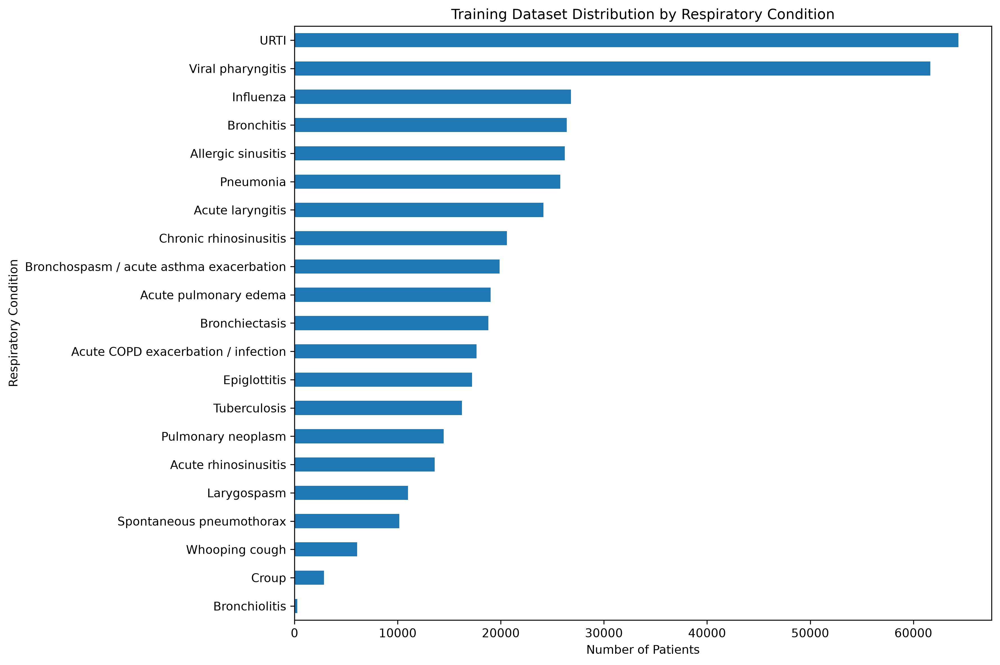
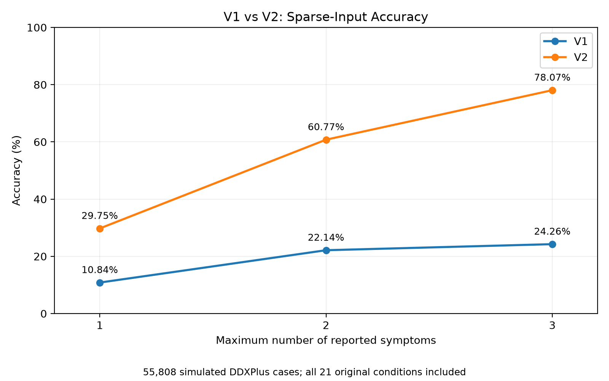
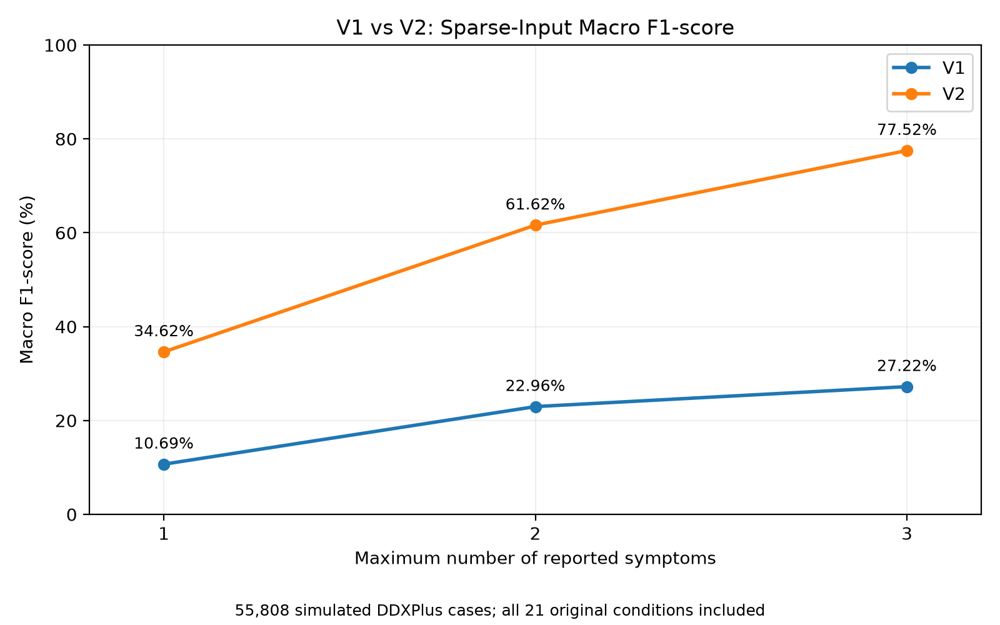
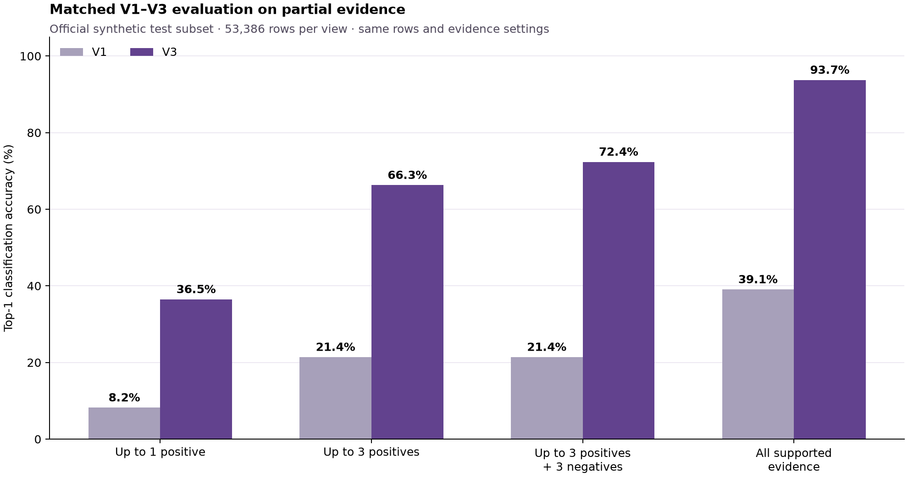
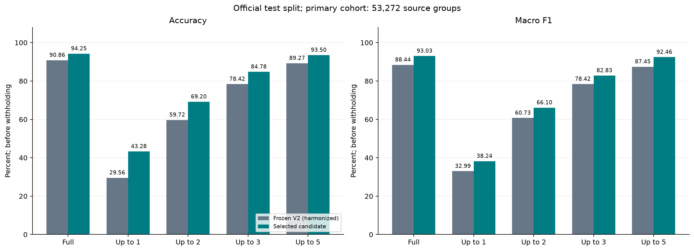
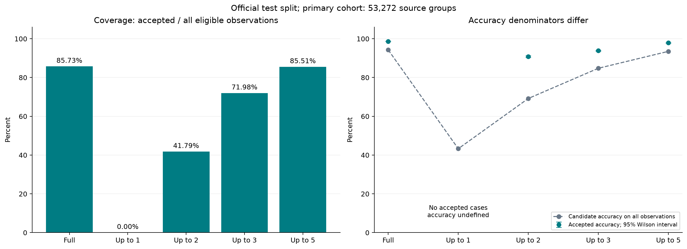
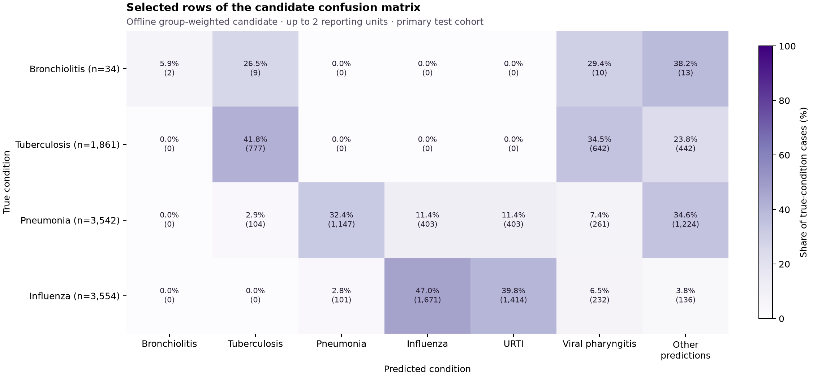
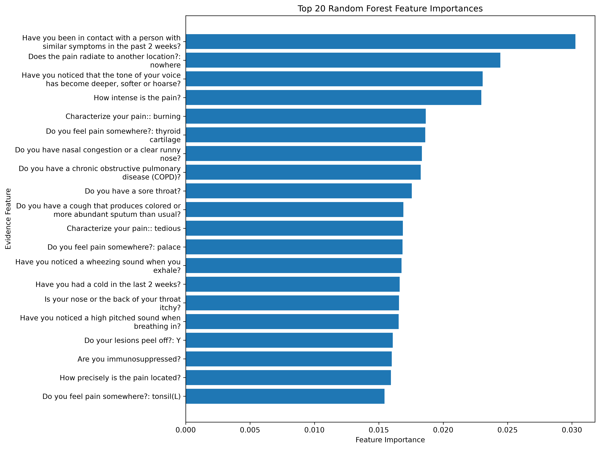
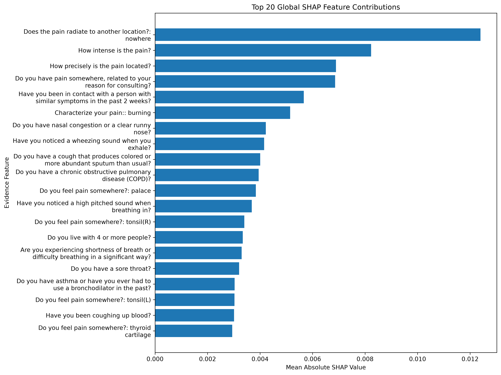

# RespiraCare | Machine Learning & NLP

RespiraCare is a respiratory health-awareness research project using simulated [DDXPlus](#references) records. This repository preserves data preparation, exploratory analysis, historical classifiers, sparse-symptom experiments, partial-evidence evaluation, explainability, and English/Kiswahili symptom mapping. The [merged research release](MERGED_RELEASE.md) documents how the sibling backend serves a verified V3 artifact.

> **Educational research only.** Synthetic-record classification is not real-patient diagnostic accuracy. A research score is not the probability that a person has a disease. The application has not been clinically validated.

## Research at a glance

The core scope is **21 respiratory-related conditions**. The original V1 Random Forest used a complete encoded evidence profile. V2 explored simulated reports with fewer symptoms. The integrated **V3 partial-evidence approach** uses 34 supported symptom features, 21 classes, present/absent/unknown states, and a frozen research selection policy that may withhold a label. A later 70-feature group-weighted Random Forest candidate is **separate offline research**, not the V3 serving artifact. English and Kiswahili aliases connect wording to confirmed symptom codes; urgent symptom handling is an independent application safeguard. See the [serving boundary](MERGED_RELEASE.md) and [detailed results guide](docs/ML_RESULTS_GUIDE.md).

### Key recorded results

| Model / evaluation | Cohort and input setting | Metric | Recorded value | Evidence |
| --- | --- | --- | ---: | --- |
| V1 original Random Forest | Official synthetic test, complete V1 input; 56,817 records | Top-1 classification accuracy | **99.44%** | [V1 test CSV](results/metrics/final_random_forest_test_results.csv) |
| V2 experimental Random Forest | Synthetic validation; up to 3 symptoms; 55,808 rows | Top-1 classification accuracy | **78.07%** | [V1/V2 sparse CSV](reports/comparison_v1_v2/sparse_all_conditions_metrics.csv) |
| V3 serving artifact, before withholding | Matched synthetic test; up to 3 positive features; 53,386 rows | Top-1 accuracy / macro F1 | **66.30% / 66.85%** | [Matched evaluation](reports/release_model_evaluation/evaluation.json) |
| V3 serving artifact, before withholding | Same matched test; up to 3 positives and 3 explicit negatives | Top-1 accuracy / macro F1 | **72.37% / 73.66%** | [Matched evaluation](reports/release_model_evaluation/evaluation.json) |
| V3 serving artifact, frozen research policy | Matched test, up to 3 positives; **13,911/53,386 accepted (26.06% coverage)** | Accuracy **among accepted rows only** | **95.07%** | [Matched evaluation](reports/release_model_evaluation/evaluation.json) |
| Later **offline** candidate, before withholding | Primary synthetic test; full view; 53,272 unique source-input groups | Top-1 accuracy / macro F1 | **94.25% / 93.03%** | [Candidate final tables](reports/candidate_final_evaluation/final_evaluation_tables.md) |
| Later **offline** candidate, frozen policy | Same primary test, full view; **45,668/53,272 accepted (85.73% coverage)** | Accuracy **among accepted cases only** | **98.68%** | [Candidate final tables](reports/candidate_final_evaluation/final_evaluation_tables.md) |

**These rows are not a leaderboard.** Cohorts, input encodings, and evaluation questions differ. V1's complete-input 99.44% is historical, not deployed V3 performance. Candidate selective accuracy excludes withheld cases. All source records are simulated.

## Model development timeline

| Stage | Method and representation | Condition scope | Role and integration |
| --- | --- | --- | --- |
| **V1** | Original Random Forest; 198 active features after feature reduction | 21 | Historical complete-profile baseline. [Saved test](results/metrics/final_random_forest_test_results.csv) |
| **V2** | Experimental sparse-symptom Random Forest; 66-feature representation | 23 candidate outputs | Historical validation. Its two added labels had no positive cases in that comparison set. [Protocol](reports/comparison_v1_v2/README.md) |
| **V3** | Verified partial-evidence artifact; 34 supported symptom features, including explicit absence and unknown states | 21 | **Integrated into the sibling backend** with frozen research selection and withholding. Different from the V1/V2 Random Forests. [Release record](MERGED_RELEASE.md) |
| **Later candidate** | Group-weighted Random Forest; 70-feature schema, controlled masking and group weighting | 21 | Distinct **offline** validation, calibration and test research. [Final report](reports/candidate_final_evaluation/README.md) |

The historical development work also compared tuned Random Forest and XGBoost configurations. Their [saved comparison](results/metrics/final_tuned_model_comparison.csv) is a separate experiment and does not establish which model the current backend serves.

## Data and exploratory analysis

The respiratory filter contains **443,075 training**, **55,808 validation**, and **56,817 test** source records across the 21-condition core scope. These are source rows before later experiment-specific exclusions and grouping. Label frequencies are uneven; macro F1 and per-condition recall therefore matter alongside accuracy. Age and sex distributions and other exploratory figures appear in the [results guide](docs/ML_RESULTS_GUIDE.md).

<p align="center"></p>

*Figure 1. Recorded training-label distribution from the original exploratory analysis.*

## Model comparison under sparse evidence

The historical [V1/V2 comparison](reports/comparison_v1_v2/README.md) uses simulated partial reports on the 55,808-row validation scope. V1 and V2 have different feature representations; these plots describe that experiment, not the matched V3 test. At **up to three reported symptoms**, V1 reached **24.26%** accuracy and **27.22%** macro F1; V2 reached **78.07%** and **77.52%**. On the same comparison's full input, V1 was stronger: **99.39%** versus V2's **89.34%** accuracy. See the separate [full-input figure](reports/comparison_v1_v2/figures/v1_v2_full_input.png) and [recorded values](reports/comparison_v1_v2/comparison_metrics.csv).

<p align="center"></p>

*Figure 2. V1/V2 sparse-input top-1 accuracy; [all-condition sparse metrics](reports/comparison_v1_v2/sparse_all_conditions_metrics.csv).*

<p align="center"></p>

*Figure 3. Macro F1 under the same historical sparse-validation protocol.*

### Matched V1/V3 partial-evidence evaluation

The [release evaluation](reports/release_model_evaluation/evaluation.json) compares V1 and the actual V3 serving artifact on the **same 53,386 eligible official-test rows** and the same evidence views. It excludes exact train-profile overlap and one record with no supported positive evidence. With up to three reported positives, V1 reached **21.41%** top-1 accuracy and V3 **66.30%**. Adding up to three explicit negatives raised V3 to **72.37%**, while V1 remained **21.41%**. V3's full-supported-evidence accuracy was **93.75%**. This is a 34-feature matched protocol: its V1 result cannot be equated with V1's original complete-profile 99.44%.

<p align="center"></p>

*Figure 4. Documentation-only plot from the frozen [matched evaluation JSON](reports/release_model_evaluation/evaluation.json); [figure provenance](docs/media/README.md).*

V3's [frozen research policy](reports/release_model_evaluation/research_selection_policy.json) can withhold a condition when evidence, score or margin is insufficient, or when a reported warning feature needs separate handling. It was selected on validation evidence and checked on the matched test; thresholds are engineering research criteria, **not clinical approval**. On the matched up-to-three-positive test view, **13,911 of 53,386 rows (26.06%)** were accepted and **95.07%** of *those accepted rows* were correctly classified. Figure 4 instead shows classification **before withholding**. Neither measure is patient risk.

## Later candidate evaluation: separate from served V3

The [group-weighted candidate](reports/candidate_model_comparison/README.md) was chosen among offline Random Forest variants using mean sparse-view macro F1 on **52,844 primary validation groups**: **69.78%**, versus **64.46%** for harmonized V2. Its [final test report](reports/candidate_final_evaluation/README.md) evaluates **53,272 eligible unique source-input groups**. Before withholding, the candidate reached **94.25%** full-view accuracy and **93.03%** macro F1, versus harmonized V2's **90.86%** and **88.44%** on that same protocol. These are not deployed V3 scores. Earlier project-level exposure to the official test is documented, so this is not claimed to be a never-inspected project-wide test.

<p align="center"></p>

*Figure 5. Classification before withholding on the candidate's primary synthetic test cohort; [exact values](reports/candidate_final_evaluation/final_evaluation_tables.md).*

The candidate's separately frozen policy accepts only some cases. On the full view it accepted **45,668/53,272 (85.73%)**, with **98.68% accuracy among accepted cases**. At up to one reporting unit it accepted **none**, so accepted accuracy is undefined. At up to two units, coverage was **41.79%** and accepted accuracy **90.82%**. Reporting only accepted accuracy would hide this trade-off.

<p align="center"></p>

*Figure 6. Selective prediction trades coverage for accuracy among accepted synthetic cases; [policy table](reports/candidate_final_evaluation/final_evaluation_tables.md).*

### Errors and confusion matrices

The focused view below contains **selected true-condition rows** of the candidate's up-to-two-unit test confusion counts. Omitted predicted classes are grouped into **Other predictions**, retaining each row's complete denominator. This is a readable excerpt, not the full 21-by-21 matrix. Bronchiolitis has only **34** eligible primary cases in this view, making its percentage especially unstable. See the [complete candidate sparse matrix](reports/candidate_final_evaluation/figures/confusion_up_to_2.png), [full-view matrix](reports/candidate_final_evaluation/figures/confusion_full.png), and [historical V1 matrix](results/figures/final_random_forest_test_confusion_matrix.png).

<p align="center"></p>

*Figure 7. Row-normalized percentages and raw counts from [saved confusion counts](reports/candidate_final_evaluation/recorded_results/evaluation/confusion_counts.csv); [figure provenance](docs/media/README.md).*

## Explainability and NLP

The original Random Forest work saved global feature importance and SHAP analyses. They describe **historical V1**, not V3's served decision rule, and do not establish clinical explanations. The [local tuberculosis SHAP example](results/figures/tuberculosis_example_shap_explanation.png) and [readable importance CSV](results/metrics/random_forest_feature_importance_readable.csv) give further detail.

<p align="center"></p>

*Figure 8. V1 feature importance reflects associations in simulated data, not causal risk factors.*

<p align="center"></p>

*Figure 9. Original V1 global SHAP summary; [saved SHAP values](results/metrics/random_forest_global_shap_importance.csv).*

The [symptom mapper](nlp/symptom_mapper.py), [English aliases](nlp/english_aliases.json), [Kiswahili aliases](nlp/swahili_aliases.json), and [canonical catalogue](nlp/canonical_symptoms.json) support controlled mapping from free text to symptom concepts. In the app, the backend checks confirmation, context and urgent symptoms before V3 assessment; see the [serving chain](MERGED_RELEASE.md). Alias coverage and language understanding have **not** been independently clinically validated. Unmatched wording must not silently become confirmed positive evidence.

### Wording, confirmation and safety

The historical mapper normalizes text, looks for alias matches, and can offer fuzzy suggestions for unmatched wording. [Its confirmation output](nlp/symptom_mapper.py) marks recognized concepts for review; a suggestion is **not** automatically a confirmed symptom. The backend's separate confirmation and red-flag checks determine whether an urgent review takes priority over model inference. These steps are distinct from V3's research selection rule and from disease classification.

## Reproducing the research

Python **3.11** was used during development. From the repository root in PowerShell:

```powershell
python -m venv .venv
.\.venv\Scripts\Activate.ps1
python -m pip install -r requirements.txt
python -m pytest tests -q
```

Some tests require original local sources and the merged sibling backend for V3 parity. `python -m pytest tests -q --ignore=tests/test_release_model_evaluation.py` excludes that parity module for ML-only checks; it is **not** a complete pass. See [release prerequisites](MERGED_RELEASE.md). This README update did **not** retrain or rerun model evaluation.

Original DDXPlus files are **not committed**. Place authorized files under `data/raw/`, or use the explicit [source restoration helper](scripts/restore_research_sources.py) after reviewing its requirements; it can download hundreds of MB. Historical preparation:

```powershell
python .\scripts\prepare_data.py .\data\raw .\data\processed
```

This preserves original source partitions and builds the historical complete representation. V1's exact 198-feature order is in [model_features.json](models/model_features.json), with [classes](models/disease_classes.json) and [metadata](models/model_metadata.json). These are **V1 artifacts**, not V3 serving files. [Readable decoding](scripts/decode_patients.py) aids inspection, not training. The matched comparison has a [documented evaluator](scripts/evaluate_release_models.py) and [saved report](reports/release_model_evaluation/); running it is unnecessary to read these records.

Historical NLP mapping commands:

```powershell
python .\scripts\build_symptom_mapping.py
python .\scripts\build_canonical_symptoms.py
python .\nlp\symptom_mapper.py "I have fever na kikohozi"
```

The deployed workflow needs the **sibling backend and frontend**; this repository alone does not reproduce served V3 inference or stored assessments. The separate [COVID experiment](reports/covid_research_final/README.md) is offline only. COVID-19 is **not** a trained V3 output class.

## Limitations

- **Synthetic evidence:** DDXPlus scores do not establish clinical validity or performance for Kenyan users or real patient narratives.
- **Sparse reports and imbalance:** Few supported symptoms can leave a condition unresolved. Rare classes and condition-specific recall can be poor despite strong aggregate metrics; see [per-condition recall](reports/candidate_final_evaluation/figures/per_condition_recall.png).
- **Overlap and test history:** Experiments have distinct exclusion/grouping rules. The candidate primary cohort excludes source-input matches to train/validation; the matched V1/V3 report removes exact-profile overlap. Earlier test exposure is recorded.
- **Scores and withholding:** Synthetic-data calibration does not make scores patient disease probabilities. Accepted-only accuracy applies only to accepted cases; the candidate withheld every one-unit case.
- **Language and safety:** Alias vocabularies are bounded. Urgent symptoms require independent handling; model labels cannot replace clinical triage.
- **Serving boundary:** V3 lives in the sibling backend. The later candidate and COVID experiment remain separate. [Release limitations](MERGED_RELEASE.md) include a medically implausible research output retained for parity.

## References

- Fansi Tchango, A., Goel, R., Wen, Z., Martel, J., & Ghosn, J. (2022). *DDXPlus: A New Dataset for Automatic Medical Diagnosis.* Advances in Neural Information Processing Systems 35, Datasets and Benchmarks Track.
- Breiman, L. (2001). Random forests. *Machine Learning, 45*(1), 5–32.
- Lundberg, S. M., & Lee, S.-I. (2017). A unified approach to interpreting model predictions. *Advances in Neural Information Processing Systems 30*.
- Pedregosa, F., et al. (2011). Scikit-learn: Machine Learning in Python. *Journal of Machine Learning Research, 12*, 2825–2830.
