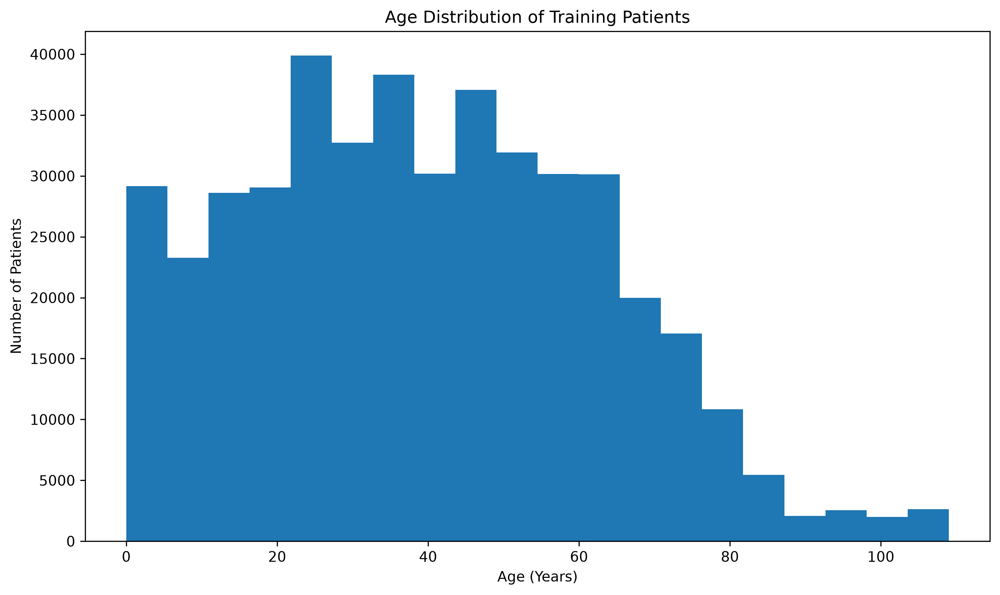
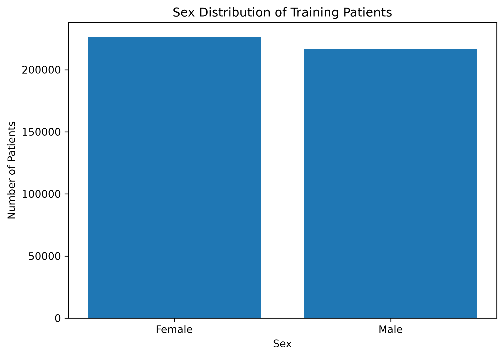
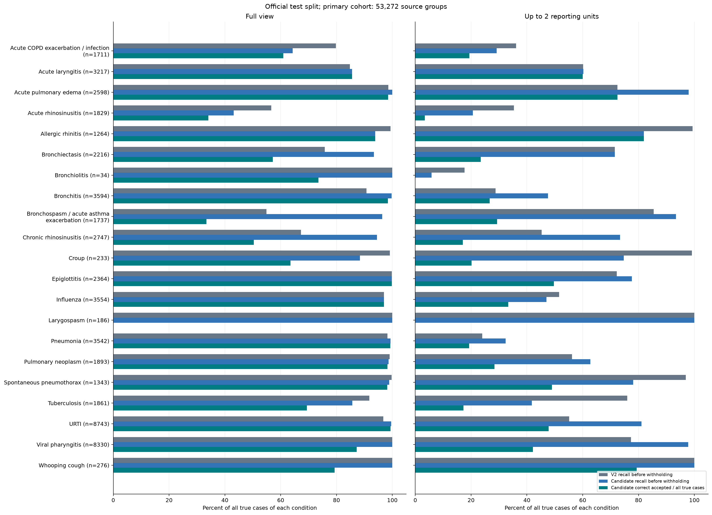
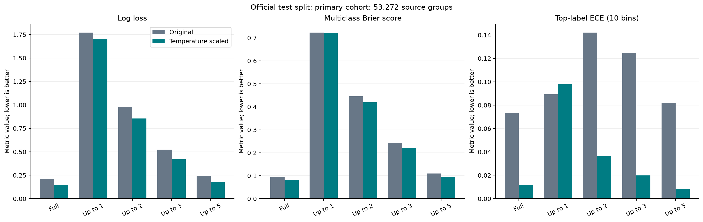

# RespiraCare ML results: figure and protocol guide

[Return to the README](../README.md). The main README keeps nine figures. These additional recorded figures let readers inspect distributions, class-specific errors, and calibration without crowding the overview.

## Exploratory distributions

The original respiratory subset contains 443,075 training source rows over 21 labels. Its age and sex figures describe the **synthetic training data**, not demographic representativeness of Kenyan patients.

*Original training age distribution. [Source PNG](../results/figures/training_age_distribution.png).*

*Original training sex distribution. [Source PNG](../results/figures/training_sex_distribution.png).*

The [age-group figure](../results/figures/training_age_groups.png) and [disease distribution](../results/figures/training_disease_distribution.png) provide complementary views.

## Protocols should stay separate

- [Historical V1 test](../results/metrics/final_random_forest_test_results.csv): original complete V1 input, 56,817 synthetic test records, 99.44% top-1 accuracy and 99.33% macro F1. V1 has 198 active model features.
- [Historical V1/V2 validation](../reports/comparison_v1_v2/README.md): different V1/V2 representations on 55,808 validation rows. The [full-input plot](../reports/comparison_v1_v2/figures/v1_v2_full_input.png) shows V1 stronger on complete inputs; the [all-condition sparse CSV](../reports/comparison_v1_v2/sparse_all_conditions_metrics.csv) shows V2 stronger when symptoms are capped. The narrower [sparse-symptom CSV](../reports/comparison_v1_v2/sparse_symptom_metrics.csv) is a different analysis and must not be substituted for the 78.07% all-condition result.
- [Matched V1/V3 test](../reports/release_model_evaluation/evaluation.json): 53,386 eligible rows per view with the same supported evidence. The 34-feature protocol differs from V1's original complete-input test. The [frozen policy](../reports/release_model_evaluation/research_selection_policy.json) is a research withholding rule, not a clinical score.
- [Later candidate final test](../reports/candidate_final_evaluation/README.md): 53,272 eligible unique source-input groups, 70-feature candidate, harmonized V2 comparator, separately frozen selective policy. It is **not** the served V3 model. Earlier project-level exposure to the test is disclosed in the report.

## Candidate condition-level errors and calibration

The candidate's full and up-to-two-unit confusion matrices are large because they contain 21 conditions. Download or open the [full-view PNG](../reports/candidate_final_evaluation/figures/confusion_full.png) and [sparse-view PNG](../reports/candidate_final_evaluation/figures/confusion_up_to_2.png) at native size. Their underlying [counts](../reports/candidate_final_evaluation/recorded_results/evaluation/confusion_counts.csv) make the focused [README excerpt](../README.md#errors-and-confusion-matrices) auditable.

*Per-condition recall matters because aggregate accuracy can hide weak labels. [Source report](../reports/candidate_final_evaluation/final_evaluation_tables.md).*

*Candidate research calibration. Lower log loss, Brier score and ECE are generally better, but calibration on simulated cases does not make scores clinical risks. In the full view, temperature scaling changed log loss from 0.208942 to 0.144749 and ECE from 0.073210 to 0.011945; the one-unit ECE worsened from 0.089345 to 0.097865. [Exact table](../reports/candidate_final_evaluation/final_evaluation_tables.md).*

The [reliability diagrams](../reports/candidate_final_evaluation/figures/reliability_diagrams.png), [candidate validation charts](../reports/candidate_model_comparison/figures/primary_metrics.png), [per-condition F1 changes](../reports/candidate_model_comparison/figures/per_condition_f1_change.png), and [per-condition recall changes](../reports/candidate_model_comparison/figures/per_condition_recall_change.png) offer additional detail.

## Historical V1 explainability

The [V1 test confusion matrix](../results/figures/final_random_forest_test_confusion_matrix.png) is best read at full size. A smaller [tuberculosis one-vs-rest matrix](../results/figures/tuberculosis_binary_confusion_matrix.png) illustrates one class in that historical V1 evaluation. The [local tuberculosis SHAP plot](../results/figures/tuberculosis_example_shap_explanation.png) explains a single historical model prediction; it must not be interpreted as why V3 served a patient-facing pattern.

## Independent COVID research

The [COVID final research report](../reports/covid_research_final/README.md) records an offline survey-source experiment. It is not part of the V3 differential, is not integrated into patient predictions, and does not validate a COVID-19 output label.
